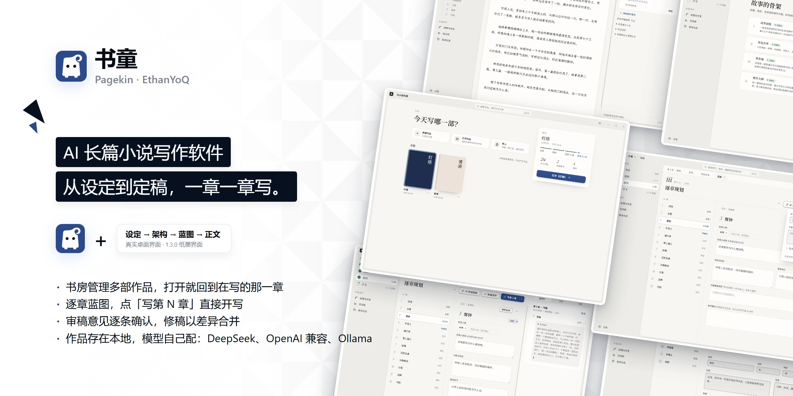
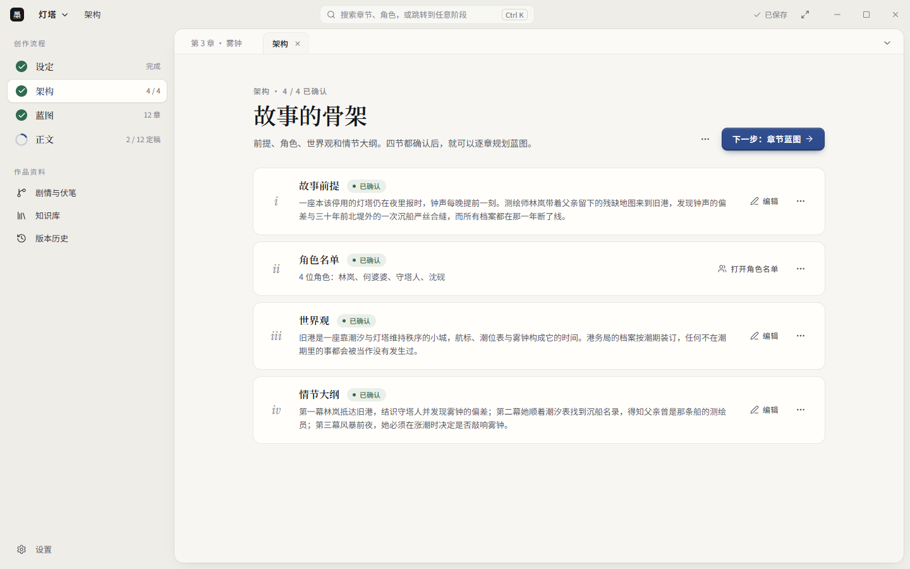
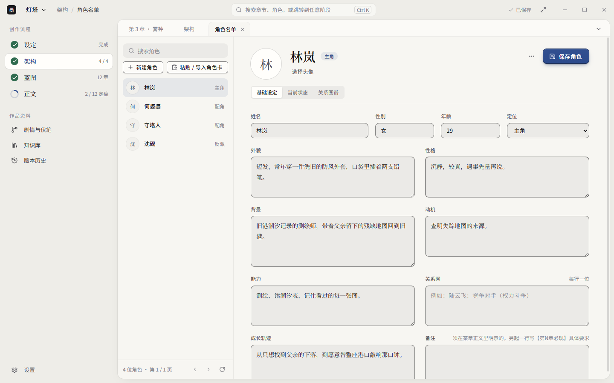
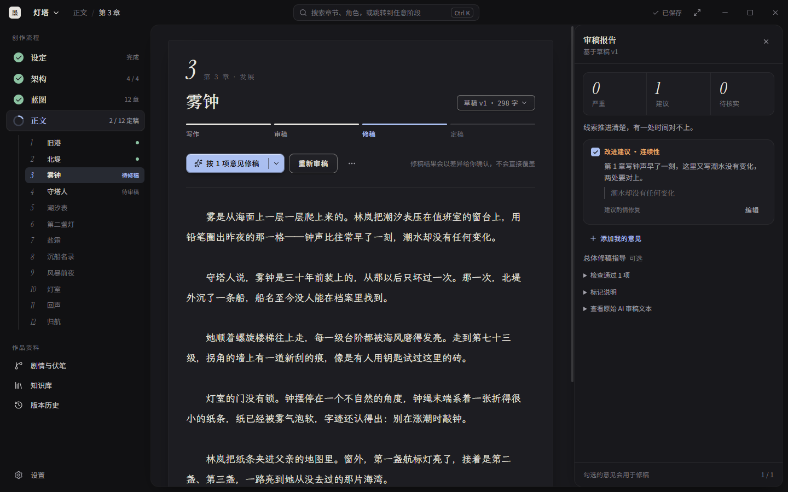

<div align="center">

[English](README_en.md) | **中文**

</div>

<p align="center">
  
</p>

<h1 align="center">书童 Pagekin</h1>

<p align="center"><sub>原名「AI 小说作家 / AI Novel Writer」</sub></p>

<p align="center">
  <strong>开源免费的 AI 小说写作桌面软件，为长篇小说和网文连载设计。</strong><br />
  从设定、架构、章节蓝图到正文、审稿、修稿、定稿，一章一章把书写完；也能拆解参考小说来仿写、导入原稿接着续写，或按你的要求改写。<br />
  本地优先：作品存在你自己的电脑上。软件不带模型：接你自己的 API Key，或用 Ollama 跑本地模型。
</p>

<p align="center">
  <a href="https://github.com/EthanYoQ/AI-Novel-Writer/releases/latest"></a><br />
  <a href="https://www.orz.md/ai-novel-writer/demo/">观看 32 秒中文实录：选段续写与改成对话</a><br />
  <sub>1.3.0 实录，模型等待段已剪短，AI 配音；32 秒是片长，不是生成耗时。</sub>
</p>

<p align="center">
  <a href="https://github.com/EthanYoQ/AI-Novel-Writer/releases"></a>
  <a href="https://github.com/EthanYoQ/AI-Novel-Writer/blob/master/LICENSE"></a>
  <a href="https://github.com/EthanYoQ/AI-Novel-Writer/stargazers"></a>
</p>

<p align="center">
  
</p>

> ## 1.3.0 更新
>
> - 整个界面换成新的「纸墨」写作界面，按设定、架构、蓝图、正文的顺序组织。
> - 一章从待写到定稿，写稿、审稿、修稿、合并、定稿都在同一页完成。
> - 蓝图页的「写第 N 章」只弹一个小弹层，不再弹大表单。
> - 所有生成任务集中在运行侧页里查看，可以取消、暂停批量、确认继续。
> - 外观只保留浅色和深色。助手聊天入口暂时隐藏，以后单独重新开放。
>
> 完整说明见 [1.3.0 更新内容](https://github.com/EthanYoQ/AI-Novel-Writer/releases/tag/v1.3.0)。

## 它能做什么

书童按写一本小说的顺序工作：你是作者，它是书童。每一步的结果都存进作品，下一步接着用。AI 负责起草，每一步由你确认。

### 书房：管理你的全部作品

书房列出你写过的每一部作品。点封面可以先看概览：写到第几步、正文字数、定稿章数、角色数。可以新建作品，也可以把旧版本的项目导入成一份副本。


### 拆解、仿写、续写与改写

书房里的「小说拆解与仿写」可以导入一部 .txt、.md 或 .epub 小说，按章拆开，导入时选择用途。

- **拆解与仿写**：选「参考小说」，AI 拆解它的结构、提取文风、反推章节蓝图，生成仿写约束，供你后面写作时参考。参考小说只进知识库和拆解结果，不会混进你的正文。
- **导入原稿续写**：选「我的原稿」，你已经写好的章节按章节号导入为定稿，AI 续写后面的章节时会接着前文的人物和情节走。
- **段落续写**：正文里选中一段文字，点工具条上的「续写」，AI 接着这段往下写。
- **改写**：整章改写用「修稿」，写下你要改的方向，也可以勾选审稿意见，修稿结果按段落和原稿对比，由你逐段决定用哪一版。改一小段时，选中文字后用工具条上的润色、扩写或改成对话。

### 设定与架构：先把故事立起来

设定页写下类型、受众、写作语言、总章数和每章字数。架构页分四节：故事前提、角色名单、世界观、情节大纲。每一节都可以让 AI 生成，也可以自己写。四节都确认后，再进入章节蓝图。



角色名单和架构放在一起编辑。每个角色有基础设定、当前状态和关系图谱。角色卡可以粘贴或从文件导入。



### 章节蓝图：动笔前先想清楚每一章

蓝图页逐章列出规划。每章写清主角小目标、冲突与转折、悬念钩子和出场人物。蓝图可以由 AI 按章节范围分批生成，中断后可以接着生成。

主按钮是「写第 N 章」。旁边的小弹层只放这一次写作的选项：用哪个模型，要不要补一句作者指导。想连写几章，用「批量创作」，一次最多 10 章。


### 正文：写稿、审稿、修稿、定稿

正文单章视图把一章从待写带到定稿。AI 写出草稿后，你可以直接改，也可以让 AI 审稿。审稿报告列出每条意见，你逐条勾选或忽略，也可以加上自己的意见。修稿结果以差异给你逐段确认，不会直接覆盖原稿。确认无误后定稿。


写作时，AI 拿到的是这一章的蓝图、相关角色、世界观、前文摘要和上一章全文，而不是整本书的聊天记录。

正文编辑器支持 Tab 插入两个全角空格作为段首缩进。写一章的全过程可以只用键盘完成。

### 运行侧页：看清 AI 正在做什么

所有生成任务都在运行侧页里，分进行中、历史、诊断三页。写作时可以实时看到输出，随时取消。批量创作可以暂停。生成失败时，已经写出的文字会留成恢复候选，可以复制或放弃。


### 作品资料与版本：写长篇不丢线索

- **剧情与伏笔**：按章节看主线、支线和伏笔的进度，记下每条线索在哪一章埋设、推进或解决。
- **知识库**：导入参考资料（.txt、.md）。没有配置检索模型时，也能用本地全文检索。
- **版本历史**：每章的历次稿件都留着，可以和当前稿对比，也可以回退成一份新草稿。
- **导出与备份**：导出为合并 Markdown、分章 Markdown 或 TXT。可以把作品打包存到本机，或备份到你绑定的 WebDAV 云端。恢复时总是另存为一份新副本。

### 写作 Skill：导入你自己的写作规则

在设置的「写作 Skills」页，可以从本机选一个 Skill 文件夹或单个 SKILL.md，也可以填 GitHub 上的 Skill 地址，导入提示词型的写作 Skill，比如「去 AI 味」、某种文风或某类题材的写法。SKILL.md 引用的 references 文本会一并装入。安装前软件会先读取并展示内容，由你检查后再安装。装好后把它绑定到规划、写稿、审稿或修稿阶段，之后这一阶段的生成都会带上它。

只支持自包含的 SKILL.md 提示词。脚本、hook、子代理和工具调用这类内容不会被安装，Skill 不能在你的电脑上执行代码。

### 深色主题与中英文界面

外观有浅色和深色两套。界面支持中文和英文。作品的写作语言可以选中文或英文。



## 支持的模型与服务

书童不提供模型，也不代管额度。你在设置里填上自己的服务地址、模型名和 API Key。软件支持两种调用协议：

- **OpenAI 兼容协议**：Chat Completions 接口兼容的服务都可以用。
- **Gemini 原生协议**：Google Gemini。

设置里内置了这些服务商的预设：

| 服务商 | 协议 | 说明 |
| --- | --- | --- |
| DeepSeek | OpenAI 兼容 | 预设地址 `https://api.deepseek.com` |
| SiliconFlow（硅基流动） | OpenAI 兼容 | 预设地址 `https://api.siliconflow.cn/v1` |
| BigModel（智谱） | OpenAI 兼容 | 预设地址 `https://open.bigmodel.cn/api/paas/v4` |
| OpenAI | OpenAI 兼容 | 预设地址 `https://api.openai.com` |
| xAI（Grok） | OpenAI 兼容 | 预设地址 `https://api.x.ai/v1` |
| Google Gemini | Gemini 原生 | 预设地址 `https://generativelanguage.googleapis.com` |
| Ollama（本地） | OpenAI 兼容 | 模型跑在你自己的电脑上 |
| NovelAI | OpenAI 兼容 | 最小兼容支持，未用真实账号完整验证 |
| 自定义 | OpenAI 兼容 | 填任意兼容服务的地址 |

「自定义」只是在上面两种协议里换地址、模型名和凭据，不是任意 HTTP 接口。Anthropic、Azure、KoboldAI 原生接口等需要单独的适配器，换个 URL 不能保证能用。

知识库的语义检索另需一个向量模型，在设置的「检索模型」里配置。

### 用 Ollama 跑本地模型

```text
服务商：   Ollama（本地）或自定义
协议：     OpenAI 兼容
Base URL： http://127.0.0.1:11434/v1
API Key：  可以留空；界面要求时填任意占位值
模型：     你的 Ollama 模型名，例如 qwen3:14b
```

向量模型也用 `/v1` 地址。不要填 `http://127.0.0.1:11434/api`，那是 Ollama 的原生接口。

## 下载与安装

请只从 [GitHub Releases](https://github.com/EthanYoQ/AI-Novel-Writer/releases/latest) 下载正式安装包。

### Windows x64

```text
ai-novel-writer-setup-<版本号>.exe
```

1. 运行安装程序。升级时安装程序只更新应用本身，不会删除作品、角色卡或设置。重要作品仍建议先备份。
2. 安装后，应用可以在「设置 → 关于与更新」里检查更新。发现新版本时先提示你，你点「下载更新」后才开始下载，下载完再选择立即重启更新或稍后。
3. 旧版便携 ZIP 不能自动获得更新器，需要手动安装一次正式安装包。

当前安装程序未进行代码签名。Windows 可能提示未知发布者。请确认下载页面是本项目的官方 GitHub Release 后再继续。

### macOS（Apple Silicon 与 Intel）

```text
ai-novel-writer-mac-arm64-<版本号>-installer.dmg
ai-novel-writer-mac-x64-<版本号>-installer.dmg
```

1. `arm64` 适用于 Apple Silicon Mac（M1、M2、M3、M4 等）。`x64` 适用于 Intel Mac。
2. 把 DMG 里的应用拖进「应用程序」文件夹后启动。应用会提示新版本，但不会在 macOS 上自动下载或替换程序。更新时打开官方 Release 页面，手动下载对应架构的安装包。
3. 两个安装包均为 ad-hoc 签名，且均未使用 Developer ID 签名或公证。Gatekeeper 阻止打开时，先确认来源是本项目的官方 GitHub Release，再在 Finder 里按住 Control 点按应用并选择「打开」，或在「系统设置 → 隐私与安全性」里允许打开。

## 数据与隐私

| 数据或行为 | 存放位置或去向 |
| --- | --- |
| 作品、角色、蓝图、草稿和定稿 | 你的作品文件夹和本地 SQLite 数据库。 |
| 生成失败的恢复候选 | 只存在当前作品的本地数据库里，不会自动变成草稿或定稿。 |
| 导入的参考资料 | 留在本地作品里，除非你把它发给云端模型。 |
| 本地模型请求 | 发给你配置的本机或局域网推理服务。 |
| 云端模型请求 | 提示词和上下文发给你选择的服务商。 |
| 模型配置与 API Key | 保存在本机应用数据目录的 `ai-novel-writer` 文件夹里（Windows 为 `%APPDATA%\ai-novel-writer`，macOS 为 `~/Library/Application Support/ai-novel-writer`）。请保护好系统账户，不要分享这个文件夹。 |
| 应用偏好 | 与模型配置在同一个文件夹里。 |

早期版本把配置存在 `~/.vela`。新版本启动时会把它复制到上面的文件夹，原目录不改动。

软件本身不提供模型账号、云端生成服务或运营消息推送。联网检查更新只读取公开的 GitHub Release。

## 常见问题

**书童免费吗？**
免费。软件以 GPL-3.0 协议开源。调用云端模型产生的费用由你和模型服务商结算，与本软件无关。用 Ollama 跑本地模型则不需要付费给任何服务商。

**需要什么模型？**
任何兼容 OpenAI Chat Completions 接口的模型都可以接，Google Gemini 走原生协议。设置里有 DeepSeek、SiliconFlow、智谱、OpenAI、xAI、Gemini、Ollama 和 NovelAI 的预设。生成质量取决于你选的模型，软件不对模型输出质量作保证。

**作品数据存在哪里？**
存在你自己的电脑上：作品文件夹加一个本地 SQLite 数据库。只有你发起生成时，相关的提示词、作品设定和上下文才会发给你配置的模型服务。

**能写多长的小说？**
总章数由你在设定里填，没有固定上限。写每一章时，AI 拿到的是这一章的蓝图、相关角色、世界观、前文摘要和上一章全文，所以不需要把整本书塞进一次对话。批量创作一次最多连写 10 章，可以多次接着写。

**支持英文写作吗？**
支持。界面有中文和英文两种，作品的写作语言也可以选中文或英文。

**旧版本的项目怎么升级到 1.3.0？**
已经装了 1.1.0 或 1.2.x 的用户，可以直接用应用内更新升级（macOS 需要手动下载新安装包）。升级不改动作品数据，旧的外观偏好会自动迁移成浅色或深色。旧版本的项目如果要转成新格式，在书房点「导入」，选择「导入旧项目副本」。导入会生成一份新副本，原项目保持不动。

**能导入 Skill 吗？比如去 AI 味。**
可以。在设置的「写作 Skills」页选择本机的 Skill 文件夹或 SKILL.md，或填 GitHub 上的 Skill 地址，检查内容后安装，再绑定到写稿或修稿等阶段。只支持提示词型的 SKILL.md，不会安装或执行脚本。

**助手聊天去哪了？**
1.3.0 的新界面暂时隐藏了助手聊天入口，以后会单独重新开放。写作、审稿、修稿等功能不受影响。

**Windows 或 macOS 提示安装包不安全怎么办？**
Windows 安装包未签名，Mac 安装包只有 ad-hoc 签名、没有经过 Apple 公证，所以系统会提示。确认安装包来自本项目的官方 GitHub Release 后，按上面「下载与安装」的步骤允许打开。

## 当前限制

- 不保证任意第三方 API 只靠 URL 和 Key 就能接入，只保证已实现的协议和预设。
- 不替代作者的创意、事实核查和版权判断。AI 写出的内容需要你审阅。
- 不提供在线发布、阅读社区或云端模型账号。

## 从源码构建

需要 Node.js 22.14 以上和仓库指定版本的 pnpm。

```sh
git clone https://github.com/EthanYoQ/AI-Novel-Writer.git
cd AI-Novel-Writer
pnpm install --frozen-lockfile
pnpm dev
```

正式安装包由 GitHub Actions 云端构建。Windows x64、macOS Apple Silicon 和 macOS Intel 三个安装包各自通过资格检查后，才进入同一个 GitHub Release。文档权威层级、ADR 和开发规则见 [`docs/README.md`](docs/README.md)。

## 参与贡献

Bug 和功能建议请提交到 [GitHub Issues](https://github.com/EthanYoQ/AI-Novel-Writer/issues)，使用问题请发到 [Discussions](https://github.com/EthanYoQ/AI-Novel-Writer/discussions)。提交 Pull Request 前请先读 [CONTRIBUTING.md](CONTRIBUTING.md)。这是公开仓库，提交内容请先脱敏，不要上传 API Key、完整小说正文或本机路径。

## DeepSeek Harness 插件（冻结维护）

仓库里还保留了 `@ethanyoq/dsh-ai-novel-writer` `0.1.0` 开发预览版，它是 DeepSeek Harness 的 Web 插件。插件目前冻结维护，短期不扩展功能。它的能力不足桌面版的 10%，不读取桌面版项目，不能替代桌面版。插件以 MIT 协议单独发布在 [npm](https://www.npmjs.com/package/@ethanyoq/dsh-ai-novel-writer)，安装与使用见[插件说明](plugins/dsh-ai-novel-writer/README.md)。

## 许可证

桌面应用以 [GPL-3.0](LICENSE) 协议开源。
