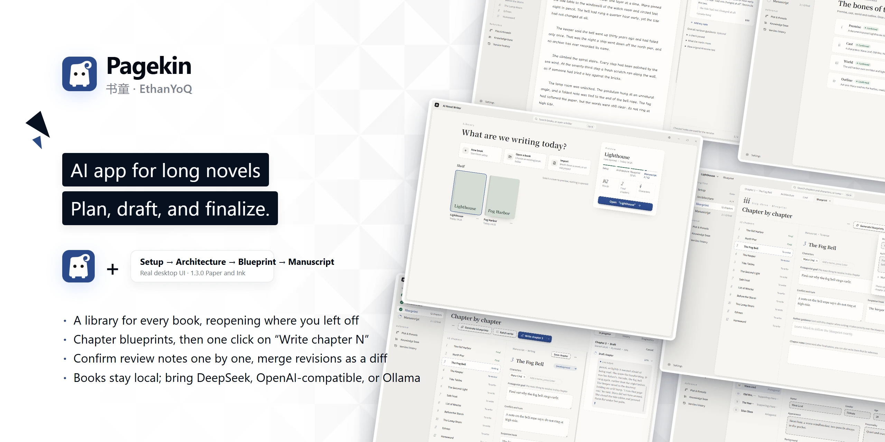
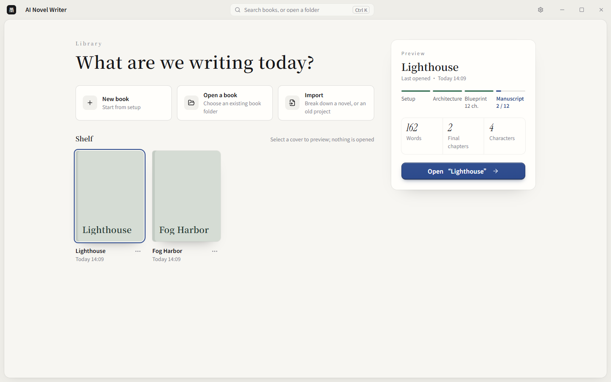
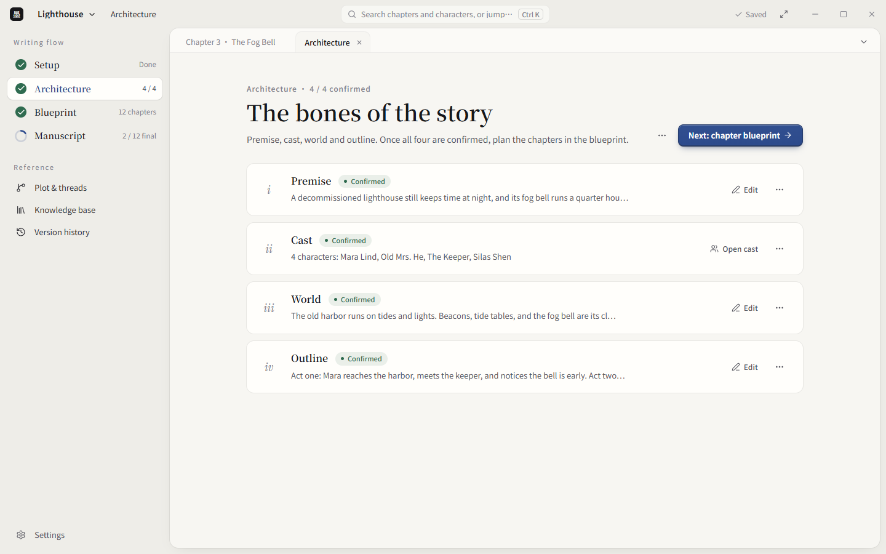
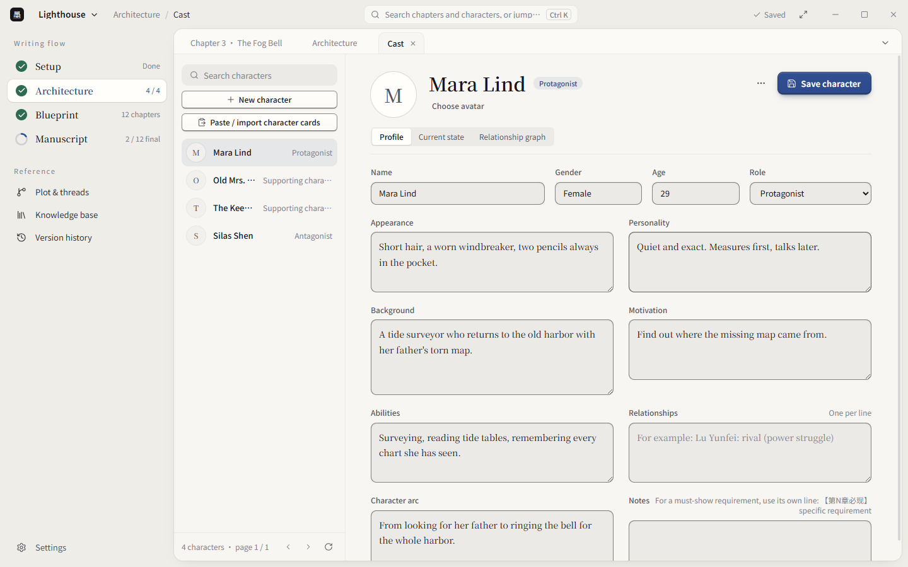
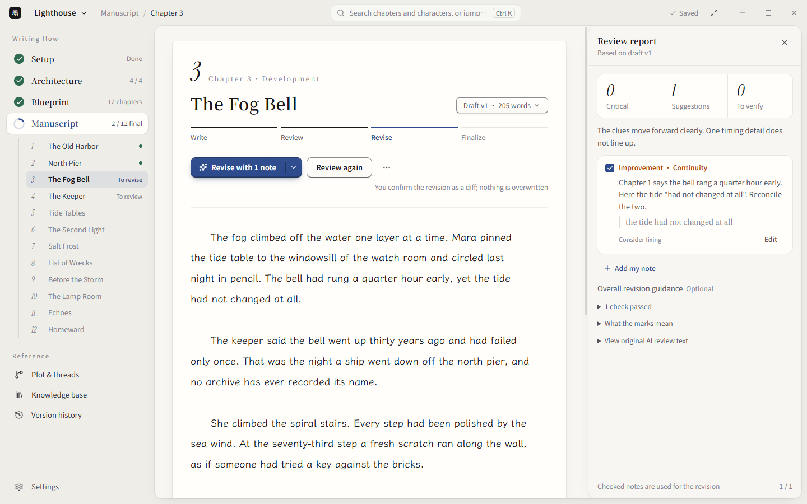
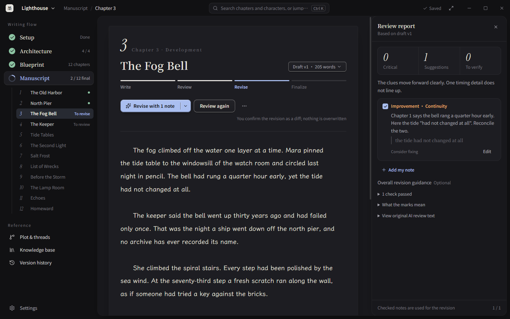

<div align="center">

**English** | [中文](README.md)

</div>

<p align="center">
  
</p>

<h1 align="center">Pagekin</h1>

<p align="center"><sub>Formerly “AI Novel Writer” (AI 小说作家). Chinese name: 书童, “the scholar’s page”.</sub></p>

<p align="center">
  <strong>Free, open-source AI novel writing software for the desktop, built for long novels and serialized web fiction.</strong><br />
  Go from setup, story architecture, and chapter blueprints to drafting, review, revision, and final chapters, one chapter at a time. You can also break down a reference novel to imitate its style, import your manuscript and continue it, or rewrite to your own instructions.<br />
  Local-first: your books stay on your own computer. No model is bundled: use your own API key, or run a local model with Ollama.
</p>

<p align="center">
  <a href="https://github.com/EthanYoQ/AI-Novel-Writer/releases/latest"></a>
</p>

<p align="center">
  <a href="https://github.com/EthanYoQ/AI-Novel-Writer/releases"></a>
  <a href="https://github.com/EthanYoQ/AI-Novel-Writer/blob/master/LICENSE"></a>
  <a href="https://github.com/EthanYoQ/AI-Novel-Writer/stargazers"></a>
</p>

<p align="center">
  
</p>

> ## What's new in 1.3.0
>
> - The whole interface is now the new Paper and Ink writing interface, organized as setup, architecture, blueprint, and manuscript.
> - A chapter goes from unwritten to final on one page: drafting, review, revision, merging, and finalization.
> - The blueprint page's "Write chapter N" opens a small popover instead of a large form.
> - Every generation run is shown in one run sheet, where you can cancel, pause a batch, or confirm continuation.
> - Appearance offers light and dark only. The assistant chat entry is hidden for now and will return separately.
>
> See the [1.3.0 release notes](https://github.com/EthanYoQ/AI-Novel-Writer/releases/tag/v1.3.0) for details.

## What it does

Pagekin works in the order a novel gets written: you are the author, it is your page. Each step is saved in the book and feeds the next one. AI drafts, and you confirm every step.

### Library: all your books in one place

The library lists every book you have written. Select a cover to preview it: the current step, word count, final chapters, and characters. You can start a new book or import a copy of a project from an older version.



### Breakdown, imitation, continuation, and rewriting

"Novel breakdown & imitation" in the library imports a novel as a .txt, .md, or .epub file, splits it into chapters, and asks what the text is for.

- **Breakdown and imitation**: choose "Reference novel". AI breaks down its structure, extracts its style, infers chapter blueprints, and produces imitation constraints for your later writing. A reference novel goes only into the knowledge base and the breakdown; it never mixes into your prose.
- **Continue your manuscript**: choose "My manuscript". The chapters you already wrote are imported by chapter number as finalized text, and AI continues the following chapters from those characters and events.
- **Continue a passage**: select text in the prose editor and choose Continue on the toolbar; AI writes on from that passage.
- **Rewrite**: to rewrite a whole chapter, use Revise. Write the direction you want, optionally check review notes, and compare the result with the original paragraph by paragraph to choose which version to keep. For a short passage, select it and use Refine, Expand, or To dialogue on the toolbar.

### Setup and architecture: build the story first

The setup page records the genre, audience, writing language, total chapters, and words per chapter. The architecture page has four sections: premise, cast, worldbuilding, and plot outline. AI can generate each section, or you can write it yourself. When all four are confirmed, move on to chapter blueprints.



The cast is edited alongside the architecture. Each character has a profile, a current state, and a relationship graph. You can paste character cards or import them from a file.



### Chapter blueprints: plan each chapter before writing

The blueprint page plans the book chapter by chapter. Each chapter states the protagonist's goal, the conflict and turn, the suspense hook, and the characters who appear. AI can generate blueprints in chapter ranges, and an interrupted run can continue.

The main button is "Write chapter N". The small popover next to it holds only the options for this run: which model to use and an optional line of author guidance. To write several chapters in a row, use "Batch write", up to 10 chapters at a time.


### Manuscript: draft, review, revise, finalize

The single-chapter view takes a chapter from unwritten to final. After AI writes a draft, you can edit it yourself or ask AI to review it. The review report lists each note. You check or ignore each one, and you can add your own. The revision comes back as a diff that you confirm paragraph by paragraph, so nothing is overwritten. When it reads right, finalize the chapter.



While writing, AI receives this chapter's blueprint, the related characters, the worldbuilding, summaries of earlier chapters, and the full previous chapter, not a chat transcript of the whole book.

In the prose editor, Tab inserts two full-width spaces as a paragraph indent. A whole chapter can be written with the keyboard alone.

### Run sheet: see what AI is doing

Every generation run appears in the run sheet, with In progress, History, and Diagnostics tabs. You can watch the output as it is written and cancel at any time. A batch can be paused. If a run fails, the text written so far is kept as a recovery candidate that you can copy or discard.


### References and versions: keep track of a long book

- **Plot & threads**: follow the main plot, subplots, and foreshadowing chapter by chapter, and record where each thread is planted, advanced, or resolved.
- **Knowledge base**: import reference material (.txt, .md). Local full-text search works even without a retrieval model.
- **Version history**: every past version of a chapter is kept. Compare it with the current draft, or restore it as a new draft.
- **Export and backup**: export as merged Markdown, one Markdown file per chapter, or plain text. Archive a book on your computer or back it up to a WebDAV cloud you connect. Restoring always creates a new copy.

### Writing skills: bring your own writing rules

On the "Writing skills" settings page, choose a local skill folder or a single SKILL.md, or enter the address of a skill on GitHub, to import a prompt-only writing skill, such as one that removes the typical AI tone, or one for a particular style or genre. Reference text files that SKILL.md cites are included. The app reads the skill and shows you its content before you install it. Bind it to the planning, drafting, review, or revision stage, and every generation in that stage includes it.

Only self-contained SKILL.md prompts are supported. Scripts, hooks, subagents, and tool requirements are not installed, so a skill cannot run code on your computer.

### Dark theme and two interface languages

Appearance offers light and dark. The interface is available in Chinese and English. A book's writing language can be Chinese or English.



## Supported models and services

Pagekin does not provide models or host quotas. In settings, enter your own service address, model name, and API key. Two request protocols are supported:

- **OpenAI-compatible**: any service compatible with the Chat Completions API.
- **Native Gemini**: Google Gemini.

Settings include presets for these providers:

| Provider | Protocol | Notes |
| --- | --- | --- |
| DeepSeek | OpenAI-compatible | Preset address `https://api.deepseek.com` |
| SiliconFlow | OpenAI-compatible | Preset address `https://api.siliconflow.cn/v1` |
| BigModel (Zhipu) | OpenAI-compatible | Preset address `https://open.bigmodel.cn/api/paas/v4` |
| OpenAI | OpenAI-compatible | Preset address `https://api.openai.com` |
| xAI (Grok) | OpenAI-compatible | Preset address `https://api.x.ai/v1` |
| Google Gemini | Native Gemini | Preset address `https://generativelanguage.googleapis.com` |
| Ollama (local) | OpenAI-compatible | The model runs on your own computer |
| NovelAI | OpenAI-compatible | Minimal compatibility, not fully verified with a real account |
| Custom | OpenAI-compatible | Any compatible service address |

"Custom" only changes the address, model name, and credentials within the two protocols above. It is not an arbitrary HTTP interface. Anthropic, Azure, native KoboldAI, and similar interfaces need dedicated adapters, and a URL swap does not make them work.

Semantic search in the knowledge base needs a separate embedding model, configured under "Retrieval model" in settings.

### Run a local model with Ollama

```text
Provider:  Ollama (local) or Custom
Protocol:  OpenAI-compatible
Base URL:  http://127.0.0.1:11434/v1
API key:   may be left blank; if the UI requires one, use any placeholder
Model:     your Ollama model name, for example qwen3:14b
```

Embedding models also use the `/v1` address. Do not use `http://127.0.0.1:11434/api`, which is Ollama's native interface.

## Download and install

Download official installers only from [GitHub Releases](https://github.com/EthanYoQ/AI-Novel-Writer/releases/latest).

### Windows x64

```text
ai-novel-writer-setup-<version>.exe
```

1. Run the installer. An upgrade updates only the application and does not delete books, character cards, or settings. Back up important work first anyway.
2. After installation, check for updates under "Settings → About & updates". A new version is announced first. It downloads only after you choose "Download update", and when it finishes you choose to restart now or later.
3. Older portable ZIP builds cannot get the updater automatically. Install an official installer manually once.

The installer is not code-signed at present. Windows may show an unknown-publisher warning. Continue only after confirming that the download page is this repository's official GitHub Release.

### macOS (Apple Silicon and Intel)

```text
ai-novel-writer-mac-arm64-<version>-installer.dmg
ai-novel-writer-mac-x64-<version>-installer.dmg
```

1. `arm64` is for Apple Silicon Macs (M1, M2, M3, M4, and later). `x64` is for Intel Macs.
2. Drag the app from the DMG to Applications and launch it. The app announces new versions but does not download or replace itself on macOS. Updating opens the official Release page so you can download the installer for your architecture.
3. Both installers are ad-hoc signed, have no Developer ID signature, and are not notarized. If Gatekeeper blocks the app, confirm that it came from this repository's official GitHub Release, then Control-click the app in Finder and choose "Open", or allow it in "System Settings → Privacy & Security".

## Data and privacy

| Data or behavior | Location or destination |
| --- | --- |
| Books, characters, blueprints, drafts, and final chapters | Your book folder and a local SQLite database. |
| Recovery candidates from failed runs | Only in the current book's local database. They never become drafts or final chapters on their own. |
| Imported reference material | Stays in the local book unless you send it to a cloud model. |
| Local model requests | Sent to the local or LAN inference service you configure. |
| Cloud model requests | Prompts and context go to the provider you choose. |
| Model settings and API keys | Stored in the `ai-novel-writer` folder of your app data directory (`%APPDATA%\ai-novel-writer` on Windows, `~/Library/Application Support/ai-novel-writer` on macOS). Protect your OS account and do not share this folder. |
| App preferences | Stored in the same folder as the model settings. |

Earlier versions kept settings in `~/.vela`. The current version copies them to the folder above at startup and leaves the original untouched.

The app does not provide model accounts, cloud generation, or promotional messages. Update checks read public GitHub Releases only.

## FAQ

**Is Pagekin free?**
Yes. It is open source under the GPL-3.0 license. Any cost of calling a cloud model is between you and the model provider. A local model through Ollama needs no provider at all.

**Which models do I need?**
Any model behind an OpenAI-compatible Chat Completions API works, and Google Gemini uses its native protocol. Settings include presets for DeepSeek, SiliconFlow, Zhipu, OpenAI, xAI, Gemini, Ollama, and NovelAI. Output quality depends on the model you choose. The app makes no promise about model output.

**Where is my data stored?**
On your own computer: the book folder plus a local SQLite database. The relevant prompts, story setup, and context are sent to your configured model service only when you start a generation.

**How long can a novel be?**
You set the total number of chapters, with no fixed limit. For each chapter, AI receives the chapter's blueprint, the related characters, the worldbuilding, summaries of earlier chapters, and the full previous chapter, so the whole book never has to fit in one conversation. Batch write handles up to 10 chapters per run, and you can keep going run after run.

**Does it support writing in English?**
Yes. The interface is available in Chinese and English, and each book's writing language can be Chinese or English.

**How do I upgrade projects from an older version to 1.3.0?**
If you have 1.1.0 or 1.2.x installed, upgrade through the in-app updater (on macOS, download the new installer by hand). Upgrading leaves your books unchanged and migrates the old appearance preference to light or dark. To convert an older project to the new format, choose "Import" in the library and then "Import an old project copy". Importing creates a new copy and leaves the original project untouched.

**Can I import skills, such as one that removes the AI tone?**
Yes. On the "Writing skills" settings page, choose a local skill folder or SKILL.md, or enter the skill's GitHub address, review its content, install it, and bind it to a stage such as drafting or revision. Only prompt-only SKILL.md files are supported; no scripts are installed or run.

**Where did the assistant chat go?**
The new 1.3.0 interface hides the assistant chat entry for now. It will return separately. Drafting, review, revision, and the rest of the workflow are unaffected.

**Windows or macOS says the installer is unsafe. What should I do?**
The Windows installer is unsigned, and the Mac installers are only ad-hoc signed and not notarized by Apple, so the system warns you. After confirming the installer came from this repository's official GitHub Release, follow the steps under "Download and install" to allow it.

## Current limits

- A URL and key alone do not guarantee that any third-party API works. Only the implemented protocols and presets are supported.
- The app does not replace your creative judgment, fact checking, or copyright decisions. Review everything AI writes.
- It does not offer online publishing, a reading community, or cloud model accounts.

## Build from source

You need Node.js 22.14 or later and the pnpm version pinned in the repository.

```sh
git clone https://github.com/EthanYoQ/AI-Novel-Writer.git
cd AI-Novel-Writer
pnpm install --frozen-lockfile
pnpm dev
```

Official installers are built in GitHub Actions. The Windows x64, macOS Apple Silicon, and macOS Intel installers each pass their own qualification before they are listed in one GitHub Release. See [`docs/README.md`](docs/README.md) for documentation authority, ADRs, and development rules.

## Contributing

Report bugs and request features in [GitHub Issues](https://github.com/EthanYoQ/AI-Novel-Writer/issues), and ask usage questions in [Discussions](https://github.com/EthanYoQ/AI-Novel-Writer/discussions). Read [CONTRIBUTING.md](CONTRIBUTING.md) before opening a pull request. This is a public repository, so remove API keys, full novel text, and local paths from anything you submit.

## DeepSeek Harness plugin (frozen)

The repository also keeps the `@ethanyoq/dsh-ai-novel-writer` `0.1.0` developer preview, a Web plugin for DeepSeek Harness. The plugin is frozen, with no short-term feature work planned. It has less than 10% of the desktop application's capabilities, does not read desktop projects, and does not replace the desktop app. It is published separately on [npm](https://www.npmjs.com/package/@ethanyoq/dsh-ai-novel-writer) under the MIT license. See the [plugin README](plugins/dsh-ai-novel-writer/README.md) for installation and use.

## License

The desktop application is open source under the [GPL-3.0](LICENSE) license.
